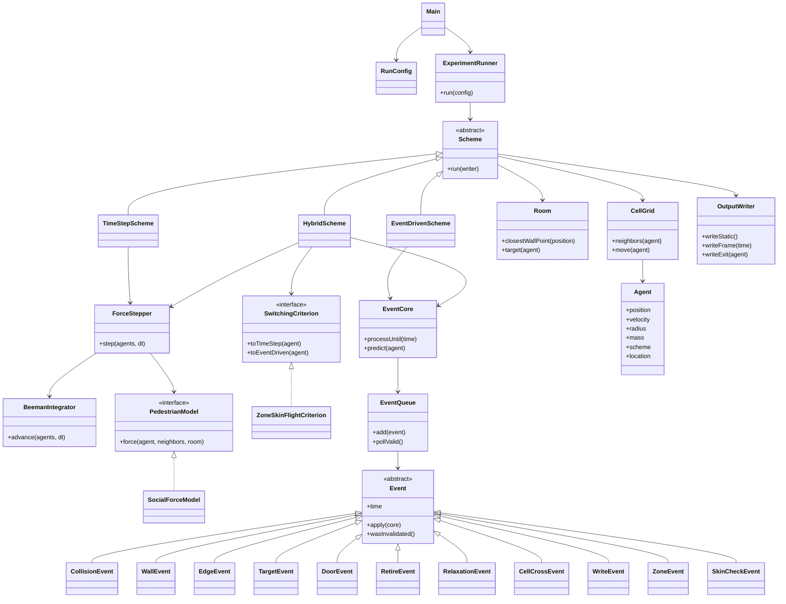

# DESIGN — TP5, Problema 2: evacuación con esquema híbrido EDMD + TSDMD

**Estado:** aprobado el 2026-11-06. Los tres esquemas están implementados (etapas 1–4); los ajustes de la etapa 4 están en `DECISIONS.md`, "Etapa 4: híbrido". El detalle de cada elección (opciones, ventajas y motivo) está en `DECISIONS.md`.

Estado de cada decisión:

- **Precedente:** sale del TP3 o el TP4 y la devolución no lo corrigió. No hace falta preguntar.
- **Confirmada:** ya la aprobaste.

Abreviaturas de fuente: `T0`, `T1`, `T5`, `T6` = Teóricas 0, 1, 5 y 6 en `sources/teoria/`. `T3` y `T4` = Teóricas 3 y 4 de los repos del TP3 y el TP4 (no están en `sources/`). `C3` y `C4` = devoluciones del TP3 y el TP4.

---

## 1. Qué se reutiliza, qué se corrige y qué es nuevo

| Pieza | Origen | Qué hacer |
|---|---|---|
| Cola de eventos, invalidación por contador, desempate por orden | TP3, `Board`, `Event` | Reutilizar |
| Tiempo de choque cuadrático, tolerancia `-1e-10` | TP3, `Particle.collides` | Reutilizar |
| Subclases de `Event` por tipo | TP3, `models/events/` | Reutilizar y sumar tipos |
| `--warmup` en la misma JVM | TP3, `Main` | Reutilizar |
| Cell Index Method | TP4, `CellGrid` (OK en C4) | Reutilizar. Generalizar a dominio rectangular y radios distintos; limpiar solo celdas ocupadas |
| Inicialización sin superposición | TP3, `generateParticle` (T3, diapo 10) | Reutilizar |
| Parser de flags, `ExperimentRunner`, `run-NNN` | TP4, `RunConfig` | Reutilizar |
| Beeman predictor-corrector | TP4, `BeemanIntegrator` | Reutilizar, adaptado a un subconjunto de agentes |
| CLI, sesiones, estadística, estilo de figuras, animación | TP4, `simulation/` | Reutilizar casi tal cual |
| Interfaz `Model` con `getKineticEnergy`/`getPotentialEnergy` | TP4 | **Corregido:** se elimina [C4, Código] |
| `conversions.txt` para reconstruir estado | TP4 | **Corregido:** el estado va en `dynamic.txt` [C4, Código] |
| Integrador elegible por CLI | TP4 | **Corregido:** uno solo [C4, Código] |
| Conteo de goles y `t90` dentro de `Main` | TP3, `Main.run` | **No copiar:** es un observable en el motor [C4] |
| Escritura cada k eventos | TP3, `Board.simulate` | **No aplica:** el enunciado pide dt₂ |
| Mover a todas en cada evento, predecir contra todas | TP3, `Board` | **No aplica** con multitud: ver decisiones 16 y 18 |
| Fuerzas tangencial y de deseo, targets, puerta, híbrido | — | Nuevo |

Los nombres de carpetas coinciden: en el TP3 y el TP4 el motor Java está en `experiment/` y el análisis Python en `simulation/`.

---

## 2. Decisiones

### Modelo y física

| # | Decisión | Propuesta | Fuente | ¿Corregida? | Estado |
|---|---|---|---|---|---|
| 1 ★ | Modelo | **SFM sin fuerza social.** Un agente a v_d hacia un target fijo tiene fuerza nula: el vuelo libre de EDMD es exacto. En CPM el radio y la velocidad cambian sin contacto, y el dt es parte del modelo | Enunciado; T6, diapos 28–33 y 45–56 | No | Confirmada |
| 2 | Parámetros | m = 80 kg, τ = 0.5 s, k_n = 1.2·10⁵ N/m, k_t = 2.4·10⁵ kg/(m·s). El enunciado no los fija y remite a los papers; **los cuatro verificados en Helbing 2000** | Enunciado; Helbing 2000; T6, diapo 33 | No | Confirmada |
| 3 ★ | Integrador TSDMD | **Beeman predictor-corrector**, ver 2.1 | T4, p. 20; C4 | Sí | Confirmada |
| 4 | dt y dt₂ | dt elegido con un estudio, ver 2.2. dt₂ = k·dt [T5, diapo 20] | T5, diapos 19–20; C4, D17 | Sí | Confirmada |
| 5 | Velocidad inicial | v₀ = v_d·ê_target: todos arrancan en vuelo libre | Decisión nueva | — | Confirmada |
| 6 | Targets | Target 1 = (L/2, R_i). Target 2 = (L/2, −2 m). Retiro en y = −1 m. Ver 2.3 | T6, diapo 57; decisión nueva | — | Confirmada |
| 7 | Paredes y puerta | Pared = segmentos; la distancia al punto más cercano del segmento resuelve pared y borde de la puerta con el mismo código. Los extremos del vano actúan como obstáculos puntuales | TP4 (imagen, OK en C4); T5, diapos 9 y 12 | No | Precedente |
| 8 | Geometría | Sala [0, L]², puerta en y = 0 centrada en x = L/2; afuera, y < 0 sin paredes | Decisión nueva | — | Confirmada |

Fuerza sobre i, con ξ_ij = R_i + R_j − |r_j − r_i| y ê^n de i hacia j [T5, diapos 8, 11 y 15; T6, diapos 29 y 31]:

```
F_i = Σ_j [ −k_n ξ ê^n − k_t ξ ((v_i − v_j)·ê^t) ê^t ] + m (v_d ê_target − v_i)/τ
```

Con los datos del test del prompt da (−1248, −336) N. Verificado a mano.

#### 2.1 Por qué Beeman (★3)

- La fuerza de deseo y la tangencial dependen de la velocidad. La variante predictor-corrector de Beeman está pensada para ese caso [T4, p. 20].
- Calcula una sola fuerza por paso.
- C4 dice que con esta fuerza Verlet y Velocity Verlet quedan en orden 1. En nuestro TP4 Beeman fue el más preciso en todo el rango de Δt.
- Costo: necesita a(t − dt). En el híbrido, al pasar a TSDMD se toma la aceleración de deseo del agente.
- La alternativa es Velocity Verlet: sin historia, más simple para el híbrido, pero de orden más bajo con estas fuerzas.

#### 2.2 Cómo elegir dt

- Referencia: 0.1·√(m/k_n) = 2.6·10⁻³ s [T5, diapo 19]. Un choque dura π/ω ≈ 0.057 s, unos 22 pasos a ese dt.
- Estudio: TSDMD puro con dt ∈ {2.5·10⁻³, 10⁻³, 5·10⁻⁴, 2.5·10⁻⁴, 10⁻⁴} s, M = 10.
- Criterio: el mayor dt cuyo ⟨t_evac⟩ difiere del de menor dt en menos de un σ. El umbral se marca en la figura [C4, D17].
- dt₂: 0.5 s en los estudios, 0.1 s en animaciones y grande para medir wall-clock.

#### 2.3 Trampa del target en el centro de la puerta (decisión 6)

Con target en (L/2, 0), un agente con |x − L/2| > y toca la pared antes de llegar. Si R = 0.2 m y arranca en (1, 2), su recta baja a y = R cuando todavía está a 2.4 m de la puerta. Después se arrastra por la pared, y en EDMD eso son eventos repetidos con tiempo casi cero.

Con target 1 = (L/2, R_i), la recta nunca baja de y = R_i, así que un agente solo no toca nada. Además da un test analítico: tiempo de salida = recorrido / v_d.

Pasa a target 2 cuando |x − L/2| < d/2 e y ≤ R_i. Un agente sobre la pared fuera del vano nunca cumple la primera condición. Al cambiar de target, la velocidad relaja hacia la nueva dirección, igual en los tres esquemas.

Alternativa: el punto del vano más cercano. Conserva el problema de la pared y además le da a cada agente un target distinto.

### EDMD

| # | Decisión | Propuesta | Fuente | ¿Corregida? | Estado |
|---|---|---|---|---|---|
| 9 ★ | Regla de choque | Impulso con restitución e. **e derivado del SFM: 0.94 entre agentes y 0.92 con paredes.** Ver 2.4 | T3, diapos 20 y 23–24; sección 6 del prompt | No | Confirmada |
| 10 ★ | Recuperación de v_d | **Eventos de relajación** con la solución exacta de la fuerza de deseo. Ver 2.5 | T6, diapo 31; decisión nueva | — | Confirmada |
| 11 | Colapso inelástico | **Piso de separación:** v_n,sal = max(e·v_n,ent, v_sep), con v_sep = 0.02 m/s. Acota la tasa de eventos con cualquier e | Decisión nueva | — | Confirmada |
| 12 | Tipos de evento | Choque agente–agente, agente–pared, agente–borde, cambio de target, cruce de puerta, retiro, relajación, cruce de celda, escritura. En el híbrido: entrada a la zona y chequeo de piel | TP3 (choques); resto nuevo | — | Confirmada |
| 13 | Tiempo de choque | Cuadrática del TP3. Borde = disco de radio 0, quieto. Zona = misma fórmula con σ = R_s | TP3, `Particle.collides`; T3, diapos 12–14 | No | Precedente |
| 14 | Cola | `PriorityQueue` por tiempo, desempate por orden de creación, todos los eventos de cada partícula | TP3, `Board`, `Event` | No | Precedente |
| 15 | Invalidación | Contador por partícula guardado en el evento. **Ajuste:** crece con todo cambio de velocidad, no solo con choques | TP3, `Event.wasInvalidated` | No | Precedente |
| 16 | Avance | **Perezoso:** (x₀, v, t₀) por partícula; `update` solo a las involucradas. El TP3 movía a todas, con costo N por evento | TP3, `Particle.update` lo permite | No, pero no escala | Confirmada |
| 17 | Qué se recalcula | Solo los eventos de las partículas involucradas | TP3, `Board.simulate` | No | Precedente |
| 18 | Vecinos | **CIM con evento de cruce de celda**, lado de celda ≥ 2·r_max. El TP3 predecía contra todas | T1, diapos 19–25; T3, diapo 28 | No, pero no escala | Confirmada |
| 19 | Escritura a dt₂ | Evento de escritura: lleva a todas al instante y escribe, costo N cada dt₂ | Enunciado; TP3 no aplica | — | Confirmada |
| 20 | Robustez | Tolerancia `-1e-10` del TP3. Con el piso de separación no hay recolisión a tiempo cero. Superposición real: el motor corta con error | TP3, `Board.scheduled` | No | Precedente |

#### 2.4 Restitución: e = 0 no es lo que hace el SFM (★9)

La primera idea fue inelástica, porque tiene más sentido para personas. Pero la referencia es el TSDMD, y su fuerza normal N.2 es un resorte sin amortiguar: el choque blando rebota casi elástico.

En un choque frontal entre iguales, la superposición cumple:

```
ξ̈ + ξ̇/τ + (2 k_n/m) ξ = 0
ω = √(2 k_n/m) = 54.8 s⁻¹
e = exp(−π/(2τω)) ≈ 0.94      (contra pared, ω = √(k_n/m) = 38.7 s⁻¹ → e ≈ 0.92)
```

La cuenta ignora la parte constante de la fuerza de deseo y la fricción tangencial, así que es una estimación. Es una derivación nuestra, no está en `sources/`.

| Opción | A favor | En contra |
|---|---|---|
| **e ≈ 0.94 (elegida)** | Sale del modelo, sin ajustar nada; debería acercar EDMD al TSDMD | Agentes que rebotan: poco intuitivo |
| e = 0 | Intuitivo para personas | Se aleja del TSDMD; más riesgo de colapso |
| e = 1 | Es el TP3, sin colapso | Ignora la disipación |

`e` queda como parámetro: se puede comparar con un piloto sin tocar código. Tangencialmente el choque es liso (c_t = 1 en T3, diapo 23), así que EDMD no tiene la fricción T.3. Esa diferencia va a aparecer en el ítem b.

#### 2.5 Relajación (★10)

Entre eventos la velocidad es constante, y la cuadrática sigue valiendo. Cada Δτ = 0.1 s, un agente perturbado aplica:

```
v ← v_d ê + (v − v_d ê)·exp(−Δτ/τ)
```

Cuando |v − v_d ê| < 0.01·v_d, se fija v = v_d ê y se cortan sus eventos de relajación.

| Opción | Problema |
|---|---|
| Instantánea | En multitud recolisiona a tiempo cero; salta la velocidad, cosa que el SFM no hace |
| Proyección sobre la tangente | Necesita saber qué contactos siguen activos, y en EDMD no hay contactos persistentes |
| **Relajación por eventos (elegida)** | Discretiza la curva en escalones de Δτ; agrega eventos pero usa el mismo τ que TSDMD |

### Híbrido

| # | Decisión | Propuesta | Fuente | Estado |
|---|---|---|---|---|
| 21 ★ | Criterios de pasaje | Zona de radio R_s + contagio por piel + tiempo de vuelo, con histéresis. Ver 2.6 | Enunciado; decisión nueva | Confirmada |
| 22 ★ | Parámetro principal | **R_s** ∈ {0, 1, 2, 3, 5, 8, 12, 20, 35, 56} m, con t_s fijo. EDMD puro se corre aparte con R_s = 0 y t_s = 0 | Enunciado, ítem c | Confirmada |
| 23 ★ | Sincronización | Reloj global de a dt; primero eventos, después paso TSDMD; pasajes en el borde del paso. Ver 2.7 | Enunciado | Confirmada |
| 24 | Colisiones | Entre dos agentes EDMD: evento duro, igual que EDMD puro; si es el segundo choque en menos de t_s, pasa a TSDMD. Entre EDMD y TSDMD: no hay, porque el EDMD pasa a TSDMD antes del contacto | Decisión nueva | Confirmada |

#### 2.6 Criterios de pasaje (★21, ★22)

**Idea:** un agente usa EDMD mientras su dinámica sea de vuelos largos y choques aislados, que es cuando EDMD es válido [T3, diapo 5]. Pasa a TSDMD cuando está cerca de la puerta, cuando se le acerca un agente que ya está en TSDMD o cuando empieza a chocar seguido.

| Símbolo | Qué es | Valor inicial |
|---|---|---|
| r_i | Distancia del agente i al centro de la puerta | — |
| g_ij | Separación entre bordes: \|r_j − r_i\| − (R_i + R_j) | — |
| t_vuelo,i | Tiempo entre el choque actual de i y su choque anterior, en EDMD | — |
| R_s | Radio de la zona alrededor de la puerta. **Parámetro principal** | Se barre |
| t_s | Tiempo de vuelo mínimo: duración de un choque blando, π/ω | 0.057 s |
| δ_in | Piel de entrada | 0.05 m |
| δ_out | Separación mínima para volver a EDMD | 0.25 m |
| h | Histéresis de la zona | 1 m |
| ε | Tolerancia de velocidad relajada | 0.05 |

**EDMD → TSDMD: alcanza con una de las tres condiciones.**

| | Condición | Qué detecta | Cuándo se evalúa |
|---|---|---|---|
| E1 Zona | r_i ≤ R_s | Cercanía a la puerta | Evento de entrada a la zona (tiempo exacto, cuadrática con σ = R_s) |
| E2 Contagio | g_ij ≤ δ_in con algún j en TSDMD | Que no haya contacto entre un agente duro y uno blando | Chequeo de piel (2.7) y cada vez que un vecino pasa a TSDMD |
| E3 Tiempo de vuelo | t_vuelo,i < t_s | Multitud formándose en cualquier lugar: EDMD deja de ser válido | Al procesar cada choque del agente, con paredes y bordes incluidos |

**TSDMD → EDMD: tienen que cumplirse las tres condiciones.**

| | Condición | Para qué |
|---|---|---|
| S1 | r_i ≥ R_s + h | Histéresis: que no entre y salga de la zona en cada paso |
| S2 | g_ij ≥ δ_out para todo j | Que no tenga a nadie cerca; δ_out > δ_in da histéresis a la piel |
| S3 | \|v_i − v_d ê_i\| ≤ ε v_d | Que ya esté casi en vuelo libre |

Se evalúan al final de cada paso. Al volver a EDMD, el "último choque" del agente se borra para que E3 no lo devuelva enseguida.

**Por qué E3 mide el vuelo entre choques y no el tiempo al próximo choque.** El tiempo al próximo choque siempre tiende a cero justo antes de chocar: con ese criterio todo choque pasaría a TSDMD y no habría ningún choque duro. El tiempo entre choques solo es corto si el agente choca seguido. Un choque aislado lo sigue resolviendo EDMD.

**Por qué t_s es la duración del choque y no dt.** Mide lo que pide la teoría: t_vuelo ≫ t_choque [T3, diapo 5]. Con dt = 10⁻³ s, t_s ≈ 57 pasos. Usar t_s = dt casi nunca dispararía, porque el piso v_sep separa los choques por más que eso. Siempre vale t_s > dt. Si t_vuelo < t_s, un agente choca más seguido de lo que dura un choque blando: el modelo de choque instantáneo ya no describe lo que pasa.

**Extremos:**

- **R_s = 0 y t_s = 0:** E1 y E3 nunca se cumplen, y sin agentes TSDMD no hay E2. Es EDMD puro.
- **R_s ≥ √((L/2)² + L²) ≈ 56 m:** todos en TSDMD desde t = 0, y S1 nunca se cumple. Es TSDMD puro.

**Qué esperar del barrido:** con t_s > 0, la multitud pasa a TSDMD por E3 aunque R_s sea chico. Entonces R_s = 0 con t_s = 0.057 s ya es híbrido, detectado solo por tiempo de vuelo, y espero una meseta desde R_s = 0 hasta el radio de la multitud (unos 7–8 m estimados). A partir de ahí, R_s agrega agentes diluidos a TSDMD y el costo sube. EDMD puro y TSDMD puro se marcan como referencia, como pide el ítem c.

| Alternativa | Por qué no |
|---|---|
| Solo distancia | Si la multitud supera R_s, quedan agentes duros en contacto con blandos |
| Solo piel | R_s no existe, y ningún valor del parámetro da EDMD puro |
| Tiempo al próximo choque | Dispara antes de todos los choques: ninguno se resolvería en EDMD |
| Densidad local o número de vecinos | Hay que medirlos para todos en cada paso, y EDMD pierde su ventaja |

#### 2.7 Convivencia y garantías (★23)

- **Eventos EDMD–TSDMD:** no se predicen, porque la trayectoria TSDMD no se conoce de antemano. Cada agente EDMD agenda un chequeo de piel para su horizonte seguro, t + (g − δ_in)/(v_i + v_max), con g la distancia al agente TSDMD más cercano en su vecindad.
- **Costo:** los agentes EDMD lejanos no cuestan nada por paso.
- **No se pierden contactos:** mientras se cumple (v_i + v_j)·dt < δ_in, el horizonte nunca deja llegar a contacto antes de un chequeo. Con v_max = 5 m/s y dt = 10⁻³ s, el movimiento relativo es de unos 7 mm por paso frente a δ_in = 50 mm. Si un agente TSDMD supera v_max, el motor corta con error. (v_max era 3 m/s; con picos medidos de hasta 3.3 m/s pasó a 5.)
- **Posición de los TSDMD durante los eventos:** quedan donde los dejó el último paso; el chequeo resta v_max·(t − t_n) al gap.
- **Grilla:** celdas de lado ≥ 2 r_max + δ_out en los tres esquemas. Fuera de las 3×3 celdas el gap es ≥ δ_out, así que S2 y el horizonte solo miran las 3×3. Cuando un TSDMD entra a una celda nueva, sus vecinos EDMD reprograman el chequeo de piel.
- **No hay superposiciones al pasar:** de EDMD a TSDMD el agente llega con g > 0. De TSDMD a EDMD exige g ≥ δ_out.
- **Fuerzas:** como nunca hay contacto cruzado, la fuerza de un agente TSDMD solo depende de agentes TSDMD. El costo por paso es proporcional a N_TS.
- **Pasaje:** el evento marca al agente; el cambio se aplica al final del paso, cuando todos están en el mismo instante.
- **Pasaje en cadena:** al pasar un agente a TSDMD se revisan sus vecinos EDMD con E2, y se repite hasta que ningún EDMD quede a menos de δ_in de un TSDMD. Sin esto, la garantía de arriba no valdría para los agentes que pasan por E1 o E3.

### Output, corridas y medición

| # | Decisión | Propuesta | Fuente | ¿Corregida? | Estado |
|---|---|---|---|---|---|
| 25 | Formato | Sección 4 | TP4; T1, diapos 36–37 | Sí: estado en `dynamic.txt` | Confirmada |
| 26 | Configuración | Flags del motor + `--seed`, `--repeats`, semillas consecutivas | TP4, `RunConfig` | No | Precedente |
| 27 | Wall-clock | `nanoTime` alrededor del loop, a `params.txt`. Es la excepción explícita a "sin observables". Con dt₂ grande, un proceso a la vez y `--warmup` | TP4, `ExperimentRunner`; TP3, `--warmup` | No | Precedente |
| 28 | Realizaciones | M = 10, misma semilla entre esquemas, σ con M − 1 | Enunciado, ítem b; T0, diapo 69; TP4, `stats.py` | C4: decir cómo se obtiene | Precedente |
| 29 | Ítem d | N ∈ {100, 200, 300, 500, 700, 1000}. Densidad constante: L = √(N/0.2). L constante: L = 50 m | Enunciado | — | Confirmada |
| 30 | CLI | Al estilo del TP4: menú y un subcomando por estudio: `timestep`, `schemes` (a y b), `runtime` (c), `scaling` (d), `animation`, `all`, `animate`, `build --check`, y `--quick`, `--session`, `--analyze-only` | TP4, `cli.py` | No | Precedente |
| 31 | Animación | matplotlib + `imageio-ffmpeg`, MP4 + PNG. Azul = EDMD, rojo = TSDMD. `animate` con fotogramas en PDF | TP4, `animation.py`, `.tex` L129–139 | No | Precedente |
| 32 | Figuras a la presentación | Un comando copia a `presentation/figuras/<ítem>/`, sin tocar `\figres`. El TP4 lo hacía a mano y compilaba en Overleaf | TP4 | No | Confirmada |

**Tiempo simulado.** Sin `tmax` por defecto: se corre hasta el último retiro. Tope de seguridad de 10⁵ s; el análisis informa si alguna corrida lo alcanza [C4, D30].

**Compilación.** Como en el TP4: `javac --release 21` invocado desde Python, sin Maven. Tests del motor en `experiment/checks/`, que no van al zip.

---

## 3. Arquitectura del motor

`EventCore` y `ForceStepper` tienen toda la lógica. Los tres esquemas solo deciden quién usa qué, y por eso la equivalencia en los extremos sale casi por construcción.

No hay interfaz `Integrator` porque queda un solo integrador. `PedestrianModel` se mantiene: separa la física del esquema.



Python (`simulation/src/simulation/`), con la misma estructura del TP4: `cli.py`, `engine.py`, `sessions.py`, `options.py`, `reader.py`, `observables.py` (N(t), t_evac, f_TS, caudal), `stats.py`, `plotting.py`, `animation.py` y `studies/`.

---

## 4. Formato de archivos

Texto separado por espacios. Cada realización va en `output/<estudio>/<fecha>/runs/<caso>/run-NNN/`.

**`static.txt`** [T1, diapo 37]

```
N
L
r1 c1        # radio y color por agente; c = esquema inicial (0 EDMD, 1 TSDMD)
...
rN cN
```

**`dynamic.txt`** [T1, diapo 36; C4]: en cada t múltiplo de dt₂, siempre las N filas.

```
t
id x y vx vy scheme location
...
```

- `scheme`: 0 EDMD, 1 TSDMD.
- `location`: 0 adentro, 1 pasó la puerta, 2 retirado. Un retirado conserva su última posición y v = 0.
- Seis decimales. Unos 18 MB por corrida a dt₂ = 0.5 s con N = 500.

**`exits.txt`** [T5, diapo 21]: registro de la dinámica, no un observable.

```
id t_door t_retire
```

Precisión dt en TSDMD y tiempo exacto en EDMD.

**`params.txt`**: `clave valor`, como en el TP4: esquema, parámetros físicos y del criterio, geometría de la puerta, dt, dt₂, semilla, `complete`, `steps`, `events`, `elapsed_ns`.

Definiciones del análisis:

- N(t): agentes con y > 0, a partir de `t_door`.
- t_evac: máximo de `t_door`.
- f_TS(t) = N_TS(t)/N(t) entre los agentes adentro, a partir de `dynamic.txt`.

---

## 5. Pseudocódigo

**TSDMD**

```
inicializar agentes; escribir estado
mientras queden agentes:
    armar celdas
    Beeman: predecir r, v → fuerzas (SFM) → corregir v
    para cada agente: cambio de target, cruce de puerta, retiro
    si n mod k = 0: escribir estado de cada agente
```

**EDMD**

```
inicializar agentes; predecir eventos de cada uno; agendar escritura
mientras queden agentes:
    e ← próximo evento válido de la cola
    t ← e.tiempo
    actualizar solo los agentes de e
    aplicar e    (choque: impulso con e y piso v_sep; agenda relajación)
    contador de los agentes de e += 1
    predecir eventos de esos agentes contra sus vecinos, paredes y bordes
```

**Híbrido**

```
inicializar; marcar en TSDMD a los agentes con r_i ≤ R_s; predecir eventos de los EDMD
para n = 1, 2, ...  mientras queden agentes:
    t' ← n·dt
    procesar eventos con tiempo ≤ t'                # agentes EDMD
        E1 (zona), E2 (piel) o E3 (t_vuelo < t_s en un choque) → marcar para TSDMD
    un paso de Beeman sobre los agentes TSDMD       # fuerzas solo entre TSDMD
    para cada TSDMD: cambio de target, puerta, retiro; verificar v ≤ v_max
    al final del paso, con todos en t':
        marcados → TSDMD: actualizar, invalidar eventos, a(t − dt) de deseo
        repetir con los EDMD a menos de δ_in de un TSDMD (E2) hasta que no quede ninguno
        TSDMD nuevos o que cambiaron de celda: sus vecinos EDMD reprograman el chequeo de piel
        TSDMD que cumplen S1, S2 y S3 → EDMD: borrar último choque, predecir eventos
    si n mod k = 0: actualizar a los EDMD; escribir estado de cada agente
```

---

## 6. Verificación

**Tests con valores a mano** (ya verifiqué los tres primeros):

- ξ = 0.01 m.
- F = (−1248, −336) N.
- t_c = 1.110 s.
- Choque elástico conserva momento; inelástico deja velocidad relativa normal e·v.
- Agente solo a v_d: fuerza nula.

**Tests agregados:**

- Agente solo sale a t = recorrido/v_d en los tres esquemas.
- Híbrido con R_s = 0 y t_s = 0 da las mismas trayectorias que EDMD puro.
- Híbrido con R_s = 56 m da las mismas que TSDMD puro.
- Ningún par EDMD–TSDMD con g ≤ 0 en ningún paso.
- Dos choques seguidos a menos de t_s pasan al agente a TSDMD; un choque aislado no.

**Chequeos de una corrida completa:**

- Superposiciones de milímetros en TSDMD.
- Q entre 1.0 y 1.6 personas/s.
- t_evac entre 300 y 500 s.

**Riesgos a mirar primero:**

- Con d = 0.8 m y diámetros de hasta 0.5 m puede haber arcos y un caudal menor al esperado. T.3 es viscosa y no traba del todo, pero hay que medirlo.
- La superposición puede dar centímetros: con 240 N de deseo por agente, una fila de 10 empuja unos 2400 N, ξ ≈ 2 cm. Si pasa, no es un error, y el chequeo de "milímetros" habría que discutirlo.
- EDMD puro puede no ser más rápido que TSDMD por la tasa de eventos en la multitud.

---

## 7. Dudas sobre el enunciado o el prompt

- **Introducción:** C3 sugiere poner EDMD/TSDMD en forma general, pero la guía 2.1 dice "ni métodos sobre cómo se resuelve". Manda la guía: la Introducción tiene solo SFM, y los esquemas van a Implementación.
- **"Salir":** tomo t_evac como el cruce de la puerta del último agente. El retiro a 1 m solo define cuándo sale de la simulación.
