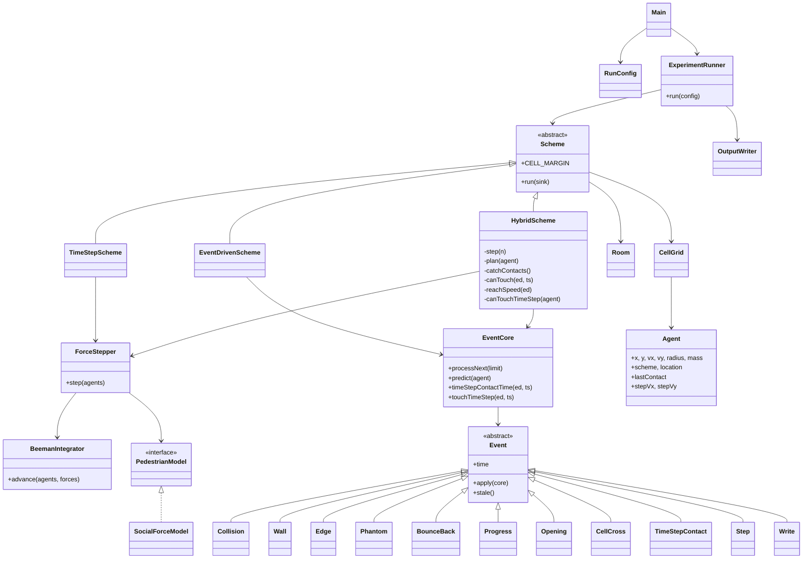

# DESIGN — TP5, Problema 2: evacuación con esquema híbrido EDMD + TSDMD

**Estado:** al día con el motor al **2026-11-25**. Aprobado el 2026-11-06 y ajustado después:

- **Etapa 9 (2026-11-20):** choque elástico del TP3.
- **Etapa 10 (2026-11-24):** un solo criterio de pasaje.
- **Etapa 11 (2026-11-25):** contacto entre esquemas predicho, con cero superposición.

El detalle de cada elección (opciones, ventajas, motivo y lo medido) está en `DECISIONS.md`. Acá queda solo lo vigente.

Estado de cada decisión:

- **Precedente:** sale del TP3 o el TP4 y la devolución no lo corrigió.
- **Confirmada:** la decidió el grupo.

Abreviaturas de fuente: `T0`, `T1`, `T5`, `T6` = Teóricas 0, 1, 5 y 6 en `sources/teoria/`. `T3` y `T4` = Teóricas 3 y 4 de los repos del TP3 y el TP4 (no están en `sources/`). `C3`, `C4` y `C5` = devoluciones del TP3, el TP4 y el TP5 (`sources/correcciones/`). `Cons.` = consideraciones de la cátedra (`sources/enunciado/TP5_Consideraciones.md`).

---

## 1. Qué se reutiliza, qué se corrige y qué es nuevo

| Pieza | Origen | Qué se hizo |
|---|---|---|
| Cola de eventos, invalidación por contador, desempate por orden | TP3, `Board`, `Event` | Reutilizado |
| Tiempo de choque cuadrático | TP3, `Particle.collides` | Reutilizado |
| Choque elástico de masas iguales | TP3, `Obstacle`, `Particle.bounce` | Reutilizado (etapa 9) |
| Subclases de `Event` por tipo | TP3, `models/events/` | Reutilizado, con tipos nuevos |
| `--warmup` en la misma JVM | TP3, `Main` | Reutilizado |
| Cell Index Method | TP4, `CellGrid` (OK en C4) | Generalizado a dominio rectangular y radios distintos, con evento de cruce de celda |
| Inicialización sin superposición | TP3, `generateParticle` (T3, diapo 10) | Reutilizado |
| Parser de flags, `ExperimentRunner`, `run-NNN` | TP4, `RunConfig` | Reutilizado |
| Beeman predictor-corrector | TP4, `BeemanIntegrator` | Reutilizado, sobre un subconjunto de agentes |
| CLI, sesiones, estadística, estilo de figuras, animación | TP4, `simulation/` | Reutilizado casi tal cual |
| Interfaz `Model` con `getKineticEnergy`/`getPotentialEnergy` | TP4 | **Corregido:** eliminada [C4, Código] |
| `conversions.txt` para reconstruir estado | TP4 | **Corregido:** el estado va en `dynamic.txt` [C4, Código] |
| Integrador elegible por CLI | TP4 | **Corregido:** uno solo [C4, Código] |
| Conteo de goles y `t90` dentro de `Main` | TP3, `Main.run` | **No copiado:** es un observable en el motor [C4] |
| Escritura cada k eventos | TP3, `Board.simulate` | **No aplica:** el enunciado pide dt₂ |
| Mover a todas en cada evento, predecir contra todas | TP3, `Board` | **No aplica** con multitud: decisiones 16 y 18 |
| Fuerza de deseo, targets, puerta, fantasmas, híbrido | — | Nuevo |

En el TP3 y el TP4 el motor Java está en `experiment/` y el análisis Python en `simulation/`. Acá también.

---

## 2. Decisiones

### Modelo y física

| # | Decisión | Vigente | Fuente | Estado |
|---|---|---|---|---|
| 1 ★ | Modelo | **SFM sin fuerza social.** Un agente a v_d hacia un target fijo tiene fuerza nula, así que el vuelo libre de EDMD es exacto. En CPM el radio y la velocidad cambian sin contacto, y el dt es parte del modelo | Enunciado; T6, diapos 28–33 y 45–56 | Confirmada |
| 2 | Parámetros | m = 80 kg, τ = 0.5 s, k_n = 1.2·10⁵ N/m (Helbing 2000). **k_t = 0**: sin fricción tangencial | Enunciado; Helbing 2000; Cons. iii | Confirmada |
| 3 ★ | Integrador TSDMD | **Beeman predictor-corrector**, ver 2.1 | T4, p. 20; C4 | Confirmada |
| 4 | dt y dt₂ | **dt = 10⁻³ s**, elegido con un estudio (2.2). dt₂ = k·dt [T5, diapo 20] | T5, diapos 19–20; C4, D17 | Confirmada |
| 5 | Velocidad inicial | v₀ = v_d·ê_target: todos arrancan en vuelo libre | Decisión nueva | Confirmada |
| 6 | Targets | Target 1 = (L/2, R_i). Target 2 = (L/2, −2 m). Retiro en y = −1 m. Ver 2.3 | T6, diapo 57 | Confirmada |
| 7 | Paredes y puerta | Pared = segmentos. Con el punto más cercano del segmento se resuelven la pared y el borde de la puerta con el mismo código. Los extremos del vano son obstáculos puntuales | TP4 (OK en C4); T5, diapos 9 y 12 | Precedente |
| 8 | Geometría | Sala [0, L]², puerta de d = 0.8 m en y = 0, centrada en x = L/2. Afuera (y < 0) no hay paredes | Enunciado | Confirmada |

Fuerza sobre i, con ξ_ij = R_i + R_j − |r_j − r_i| y ê^n de i hacia j [T5, diapos 8, 11 y 15; T6, diapos 29 y 31]:

```
F_i = Σ_{j: ξ_ij > 0} [ −k_n ξ_ij ê^n_ij ] + m (v_d ê_target − v_i)/τ        (k_t = 0)
```

La pared ejerce la misma fuerza de contacto, como un agente quieto ubicado en el punto más cercano del segmento.

#### 2.1 Por qué Beeman (★3)

- La fuerza de deseo depende de la velocidad, y la variante predictor-corrector de Beeman está pensada para ese caso [T4, p. 20].
- Calcula una sola fuerza por paso.
- Según C4, con esta fuerza Verlet y Velocity Verlet quedan en orden 1. En el TP4, Beeman fue el más preciso en todo el rango de Δt.
- Necesita a(t − dt). En el híbrido, al pasar a TSDMD se toma a(t) = a(t − dt) = la aceleración de deseo, después de aplicar la relajación pendiente.
- **La posición en t + dt solo usa el estado en t:** r(t+dt) = r + v·dt + (2/3·a(t) − 1/6·a(t−dt))·dt². La corrección cambia la velocidad, no la posición. Gracias a esto, el híbrido conoce el tramo de cada TSDMD hasta el próximo paso (2.7).

#### 2.2 Cómo se eligió dt

- Referencia: 0.1·√(m/k_n) = 2.6·10⁻³ s [T5, diapo 19]. Un choque dura π/ω ≈ 0.057 s.
- Estudio: TSDMD puro con dt ∈ {2.5·10⁻³, 10⁻³, 5·10⁻⁴, 2.5·10⁻⁴, 10⁻⁴} s, N = 200, M = 10.
- Criterio: el mayor dt con ⟨t_evac⟩ a menos de un σ del de menor dt. **Los cinco lo cumplen; se usa dt = 10⁻³ s.**
- dt₂: 0.5 s en los estudios, 0.1 s en las animaciones y 5 s al medir el tiempo de ejecución.

#### 2.3 Trampa del target en el centro de la puerta (decisión 6)

Con el target en (L/2, 0), un agente con |x − L/2| > y toca la pared antes de llegar. Con R = 0.2 m arrancando en (1, 2), su recta baja a y = R cuando todavía le faltan 2.4 m hasta la puerta. Después se arrastra por la pared, y en EDMD eso son eventos repetidos casi a tiempo cero.

Con target 1 = (L/2, R_i), la recta nunca baja de y = R_i: un agente solo no toca nada. Además da un test analítico: tiempo de salida = recorrido / v_d.

Pasa a target 2 cuando |x − L/2| < d/2 e y ≤ R_i. Un agente apoyado en la pared fuera del vano nunca cumple la primera condición. Al cambiar de target, la velocidad relaja hacia la nueva dirección, igual en los tres esquemas.

### EDMD

| # | Decisión | Vigente | Fuente | Estado |
|---|---|---|---|---|
| 9 ★ | Regla de choque | **Elástico, c_n = 1, masas iguales: el choque del TP3.** Se intercambian las componentes normales. Ver 2.4 | T3, diapo 20; TP3 | Confirmada (etapa 9) |
| 10 ★ | Recuperación de v_d | **Eventos fantasma** con la solución exacta de la fuerza de deseo, cada Δt_f = R_i / max(\|v_i\|, v_d). Ver 2.5 | T6, diapo 31; nota del profesor | Confirmada |
| 11 | Contactos lentos | Sin piso de separación. Dos agentes que se tocan con superposición de redondeo (≤ 10⁻⁹ m) y se acercan chocan en t = 0. Más que eso es un error y el motor corta | Etapa 9 | Confirmada |
| 12 | Tipos de evento | `Collision` (agente–agente), `Wall`, `Edge` (borde de la puerta), `Phantom`, `BounceBack`, `Progress` (target, puerta, retiro), `Opening` (entra de costado al vano), `CellCross`, `Write`. En el híbrido, además: `Step` y `TimeStepContact` (guardia: corta con error si ocurre) | TP3 (choques); resto nuevo | Confirmada |
| 13 | Tiempo de choque | Cuadrática del TP3. Borde = disco de radio 0, quieto | TP3, `Particle.collides`; T3, diapos 12–14 | Precedente |
| 14 | Cola | `PriorityQueue` por tiempo. Empates: por rango (agentes, después `Step`, después `Write`) y por orden de creación | TP3, `Board`, `Event` | Precedente |
| 15 | Invalidación | Contador (`revision`) por agente, guardado en el evento. Crece con **todo** cambio de velocidad o de esquema, no solo con choques | TP3, `Event.wasInvalidated` | Precedente |
| 16 | Avance | **Perezoso:** (x₀, v, t₀) por agente. Solo se mueven los agentes del evento. El TP3 movía a todos, con costo N por evento | TP3, `Particle.update` lo permite | Confirmada |
| 17 | Qué se recalcula | Solo los eventos de los agentes involucrados | TP3, `Board.simulate` | Precedente |
| 18 | Vecinos | **CIM con evento de cruce de celda.** Celdas de lado ≥ 2 r_max + 2 cm = 0.52 m, las mismas en los tres esquemas (el margen es para el híbrido, ver 2.7). El cruce se agenda 10⁻⁹ m pasado el borde: es una distancia, no un tiempo | T1, diapos 19–25; T3, diapo 28 | Confirmada |
| 19 | Escritura a dt₂ | Evento de escritura: lleva a todos al instante y escribe. Cuesta N cada dt₂ | Enunciado | Confirmada |
| 20 | Corte | `--max-time` y `--max-events` → `complete false`. **Que no termine es un resultado válido** | Cons. iii | Confirmada |

#### 2.4 El choque: elástico, como en el TP3 (★9)

```
J = m (Δv · n̂)          con Δv = v_j − v_i y n̂ = (r_j − r_i)/(R_i + R_j)
v_i' = v_i + (J/m) n̂     v_j' = v_j − (J/m) n̂
```

- Con masas iguales y c_n = 1, se intercambian las componentes normales y las tangenciales quedan como estaban.
- En el código, con Δr = r_j − r_i: k = Δv·Δr / |Δr|², v_i += k Δr, v_j −= k Δr.
- **Pared y borde de la puerta:** espejo, v' = v − 2(v·n̂)n̂. Es el caso de un agente quieto de masa infinita.
- El motor verifica que todas las masas sean iguales.

**Antes** (hasta la etapa 9) era inelástico, con e = 0.94 entre agentes y 0.92 con paredes, derivado del SFM, más un piso v_sep. Se descartó porque tenía dos parámetros derivados y un piso ad hoc, y era difícil de explicar. Detalle en `DECISIONS.md`, etapa 9.

#### 2.5 Recuperación de v_d: eventos fantasma (★10)

Entre eventos la velocidad queda fija, así que la cuadrática sigue valiendo. En cada fantasma se aplica la solución exacta de m dv/dt = m(v_d ê − v)/τ:

```
v(t + Δt_f) = v_d ê + [v(t) − v_d ê] · exp(−Δt_f/τ)
Δt_f,i      = R_i / max(|v_i|, v_d)        "lo que tarda en recorrer su radio" (≈ 0.12–0.17 s)
```

- **Choques durante la recuperación:** un choque no reinicia el fantasma pendiente. La fuerza es lineal en v, así que cada impulso Δv_k decae **solo desde su instante** t_k: v = v_d ê + [v(t₀) − v_d ê]·e^{−(t−t₀)/τ} + Σ_k Δv_k·e^{−(t−t_k)/τ}.
- **Bounce back:** si |v − v_d ê| < ε_b·v_d, con ε_b = 0.01, se fija v = v_d ê y se cortan los fantasmas.

| Opción | Problema |
|---|---|
| Recuperación instantánea | En la multitud recolisiona a tiempo cero; además salta la velocidad, cosa que el SFM no hace |
| Proyección sobre la tangente | Necesita saber qué contactos siguen activos, y en EDMD no hay contactos que persistan |
| **Fantasmas (elegida)** | Discretiza la curva exacta en escalones de Δt_f; agrega eventos, pero usa el mismo τ que TSDMD |

### Híbrido

| # | Decisión | Vigente | Fuente | Estado |
|---|---|---|---|---|
| 21 ★ | Criterio de pasaje | **Uno solo: el tiempo entre contactos Δt_i contra t_s**, en los dos sentidos, con Δt_i = 0 para un contacto con el otro esquema. Ver 2.6 | Enunciado; C5; T3, diapo 5 | Confirmada (etapas 10 y 11) |
| 22 ★ | Parámetro principal | **t_s**, por defecto π/ω = 0.057 s. Barrido del ítem c: {10⁻³, 3·10⁻³, 10⁻², 3·10⁻², 0.1, 0.3, 1, 3} s más π/ω, en eje log. t_s = 0 es EDMD puro | Enunciado, ítem c | Confirmada (etapa 10) |
| 23 ★ | Sincronización | Reloj global = la cola de eventos. El paso de Beeman es un evento `Step` en n·dt, que existe solo mientras haya TSDMD o marcados. Mismo instante: agentes → `Step` → escritura. Los pasajes se aplican en el `Step`. Ver 2.7 | Enunciado; nota del profesor (2026-11-13) | Confirmada |
| 24 | Contactos | EDMD–EDMD: choque duro, como en EDMD puro. EDMD–TSDMD: **nunca ocurre**: el EDMD que puede tocar a un TSDMD antes del próximo paso pasa antes (la predicción sobre el tramo queda como guardia). TSDMD–TSDMD: fuerza blanda | Etapas 11 y 12 | Confirmada |

#### 2.6 El criterio de pasaje (★21, ★22)

**Idea:** un agente usa EDMD mientras tenga vuelos largos y choques aislados, que es cuando el choque instantáneo vale: t_vuelo ≫ t_choque [T3, diapo 5]. Cuando choca más seguido de lo que dura un choque blando, EDMD deja de valer y pasa a TSDMD.

```
          ⎧ t − t_i^ant   si el contacto es con un agente del MISMO esquema, una pared o un borde
Δt_i  =   ⎨
          ⎩ 0             si el contacto es con un agente del OTRO esquema

EDMD → TSDMD :  Δt_i < t_s
TSDMD → EDMD :  t − t_i^ant ≥ t_s, y ningún contacto posible con el otro esquema antes del próximo paso

contacto con un TSDMD j:  i PUEDE tocarlo antes del próximo paso  ⇔  gap_ij(t) ≤ (s_i + |u_j|)·dt

t_s = π/ω,   ω = √(2 k_n / m)        (duración de un choque blando frontal entre dos agentes)
```

| Símbolo | Qué es |
|---|---|
| t_i^ant | Instante del contacto anterior del agente i (`lastContact`): cada choque en EDMD, cada `Step` con superposición en TSDMD. No se resetea al volver |
| t_s | Único parámetro del híbrido |
| gap_ij(t) | Separación en el paso: \|r_j − r_i\| − R_i − R_j |
| u_j | Velocidad del tramo del TSDMD j hasta el próximo paso (2.7) |
| s_i | Velocidad máxima que el EDMD i puede tener en el paso: √2 · max(\|v_i\|, v_d, \|v_k\| de los EDMD vecinos) |

- **¿Por qué 0 con el otro esquema?** El contacto con un agente blando no es instantáneo: dura unos t_s. Mientras dura, el próximo contacto está encima, a 0 < t_s. No es un segundo criterio: es el mismo, aplicado a un contacto que dura.
- **¿Por qué "puede tocarlo" y no "lo toca yendo derecho"?** (Etapa 12) Un TSDMD solo existe en la grilla n·dt, así que un EDMD solo puede pasar en un paso. Si un evento a mitad de paso (pared, borde, otro EDMD) lo desvía hacia un tramo, ya no puede pasar a tiempo. Por eso el contacto cuenta si **puede** ocurrir antes del próximo paso: lo que recorren los dos en un dt, en cualquier dirección. Es la resolución temporal de TSDMD aplicada a detectar el contacto; no es un parámetro (3 a 6 mm con dt = 1 ms). s_i acota la velocidad en el paso: paredes y bordes conservan |v|, los fantasmas la llevan hacia v_d, y un choque elástico de masas iguales conserva |v_i|² + |v_k|² (a lo sumo √2 veces el más rápido).
- **La vuelta usa la misma regla.** Si un TSDMD volviera justo antes de tocar a otro TSDMD, ese contacto sería con el otro esquema (Δt = 0) y tendría que pasar de nuevo. Por eso espera.
- **Todos arrancan en EDMD.** El primer choque nunca dispara el pasaje: hace falta un segundo choque a menos de t_s. Un agente que vuelve ya pasó t_s sin contacto, así que su próximo choque solo tampoco lo devuelve.

**Por qué el tiempo entre choques y no el tiempo al próximo choque.** El tiempo al próximo choque tiende a cero justo antes de cada choque: con ese criterio todo choque pasaría a TSDMD y no quedaría ningún choque duro.

**Extremos:**

- **t_s = 0:** Δt_i < 0 nunca se cumple. Es EDMD puro, bit a bit (testeado).
- **Ningún t_s da TSDMD puro:** todos arrancan en EDMD y pasan recién en su segundo contacto. TSDMD puro va como banda de referencia en el ítem c, que es lo que pide el enunciado.

**Qué pasó con los otros criterios.** Hasta la etapa 10 había tres de entrada (E1 zona, E2 contagio, E3 tiempo de vuelo) y tres de vuelta (S1–S3). La cátedra pidió uno solo (C5), y quedó E3 con su recíproca. Detalle en `DECISIONS.md`, etapa 10.

| Alternativa | Por qué no |
|---|---|
| Distancia a la puerta (zona R_s) | No detecta una multitud fuera de la zona; si la multitud supera R_s, quedan duros contra blandos |
| Contagio por cercanía (piel δ_in) | Solo propaga: necesita otro criterio que cree el primer TSDMD, y agrega parámetros |
| Tiempo al próximo choque | Dispara antes de todos los choques: ninguno se resolvería en EDMD |
| Densidad local o número de vecinos | Hay que medirlos para todos en cada paso, y EDMD pierde su ventaja |

#### 2.7 Convivencia y garantías (★23)

**El tramo.** Beeman da r_j(t+dt) con el estado en t (2.1). Entre dos pasos, cada TSDMD recorre un **tramo** recto conocido, de r_j(t) a r_j(t+dt), con velocidad u_j = (r_j(t+dt) − r_j(t))/dt. En los instantes del paso coincide exactamente con Beeman; entre pasos, TSDMD no define posiciones, así que el tramo es la interpolación natural.

**Eventos EDMD–TSDMD.** No deberían ocurrir nunca: el EDMD que puede tocar un tramo ya pasó a TSDMD en el paso (caso 1). Igual se predicen, como guardia, con la misma cuadrática de EDMD contra el tramo: |Δr + Δv·t_c| = R_i + R_j, con Δv = u_j − v_i, solo dentro del paso en curso. Si uno ocurriera, el motor corta con error.

| Caso | Qué pasa | Superposición |
|---|---|---|
| **1. En el paso** | En el `Step` de t, cada EDMD vecino de un TSDMD que **puede** tocarlo antes de t+dt (gap ≤ (s_i + \|u_j\|)·dt) pasa a TSDMD **en t, antes de tocarlo**. Es en cadena: el que pasa también tiene su tramo, y se revisan sus vecinos | 0 |
| **2. A mitad del paso** | No puede pasar: el que podía tocarlo ya pasó en el caso 1. `predict()` sigue prediciendo contra los tramos como guardia y el motor corta con error si ocurre. (Hasta la Etapa 11 el chequeo suponía vuelo recto y acá había un rebote contra el tramo; con t_s chico un EDMD atrapado entre una pared y un TSDMD se aceleraba sin límite. Ver `DECISIONS.md`, Etapa 12) | 0 |
| **3. La vuelta** | Un TSDMD vuelve solo si no toca a nadie (agentes ni paredes), pasó t_s y no puede tocar ningún TSDMD antes de t+dt | 0 |

**Garantías:**

- **No hay superposiciones en el pasaje**, en ningún sentido (casos 1–3). El check lo exige con tolerancia de 10⁻⁹ m. El gap mínimo medido entre un EDMD y un TSDMD en cualquier paso es 2.1 mm.
- **No se pierden contactos.** Contra EDMD se predicen como siempre y contra TSDMD, sobre el tramo. El CIM siempre encuentra al TSDMD: queda registrado en la celda de r(t) mientras recorre el tramo, y las celdas tienen 2 cm de margen sobre 2 r_max. El motor corta con error si un TSDMD se mueve más que el margen en un dt, o si lo que pueden recorrer un EDMD y un TSDMD en un dt lo supera (más de 20 m/s; el máximo medido es ~3 m/s).
- **Fuerzas:** solo entre TSDMD. Como ningún EDMD toca a un TSDMD, no falta ninguna fuerza.

**Sincronización:**

- La cola de eventos es el reloj global, como en EDMD puro. Los TSDMD avanzan en eventos `Step` en n·dt. Sin ningún TSDMD no hay `Step`, y el híbrido va de evento en evento.
- Un agente marcado sin `Step` pendiente agenda el próximo de la grilla n·dt. Así las escrituras (k·dump·dt) siempre encuentran a los TSDMD en su instante.
- **Orden del `Step` de t:** Beeman de los TSDMD → progreso (target, puerta, retiro) → tramos hasta t+dt → ventana [t, t+dt] → marcados a TSDMD → caso 1 en cadena → caso 3 → si quedan TSDMD, `Step` en t+dt.
- **Al entrar a TSDMD:** se aplica la relajación pendiente, se invalidan sus eventos y a(t) = a(t − dt) = deseo.
- **Al volver a EDMD:** sigue en vuelo recto con su velocidad, y los fantasmas relajan lo que quede de desvío.
- **Costo de un paso:** proporcional a N_TS. Los EDMD no se mueven hasta su próximo evento.

### Output, corridas y medición

| # | Decisión | Vigente | Fuente | Estado |
|---|---|---|---|---|
| 25 | Formato | Sección 4 | TP4; T1, diapos 36–37 | Confirmada |
| 26 | Configuración | Flags del motor + `--seed`, `--repeats`, semillas consecutivas | TP4, `RunConfig` | Precedente |
| 27 | Wall-clock | `nanoTime` alrededor del loop, a `params.txt`. Es la excepción explícita a "sin observables". En serie, 2 calentamientos, dt₂ = 5 s | TP4; TP3, `--warmup` | Precedente |
| 28 | Realizaciones | M = 10 (M = 3 en el ítem d), mismas semillas en los tres esquemas, σ con M − 1. Los promedios usan solo las corridas completas | Enunciado, ítem b; T0, diapo 69 | Confirmada |
| 29 | Ítem d | N ∈ {100, 200, 300, 500, 700, 1000}. Densidad constante: L = √(N/0.2). L constante: L = 50 m. EDMD puro hasta N = 500 | Enunciado | Confirmada |
| 30 | CLI | Al estilo del TP4: menú y un subcomando por estudio: `timestep`, `schemes` (a y b), `runtime` (c), `scaling` (d), `animation`, más `figures` | TP4, `cli.py` | Precedente |
| 31 | Animación | matplotlib + `imageio-ffmpeg`, MP4 + PNG + fotogramas en PDF. Azul = EDMD, rojo = TSDMD | TP4 | Precedente |
| 32 | Figuras a la presentación | `simulation figures` copia a `presentation/figuras/<ítem>/` | TP4 | Confirmada |

**Tiempo simulado.** Se corre hasta el último retiro. Tope de seguridad: 10⁵ s en el motor, 1000 s en los estudios con N = 200 y 1.5 s × N en el ítem d. Una corrida trabada llega al tope, y se informa [C4, D30; Cons. iii].

**Compilación.** Como en el TP4: `javac --release 21` invocado desde Python, sin Maven. Los checks del motor están en `experiment/checks/` y no van al zip.

---

## 3. Arquitectura del motor

`EventCore` y `ForceStepper` tienen toda la lógica. Los tres esquemas solo deciden quién usa qué; por eso la equivalencia de t_s = 0 con EDMD puro sale por construcción.

No hay interfaz `Integrator` porque queda un solo integrador. `PedestrianModel` se mantiene: separa la física del esquema. El criterio vive en `EventCore` (choques y contactos con tramos) y en `HybridScheme` (el `Step`); no hace falta una interfaz, porque hay uno solo.



Python (`simulation/src/simulation/`) tiene la misma estructura del TP4: `cli.py`, `engine.py`, `sessions.py`, `options.py`, `reader.py`, `observables.py` (N_in(t), t_evac, f_TS, caudal), `stats.py`, `plotting.py`, `animation.py`, `export.py` y `studies/`.

---

## 4. Formato de archivos

Texto separado por espacios. Cada realización va en `output/<ítem>-<estudio>/<fecha>/runs/<caso>/run-NNN/`.

**`static.txt`** [T1, diapo 37]

```
N
L
d
r1 c1        # radio y esquema inicial por agente (0 EDMD, 1 TSDMD)
...
rN cN
```

**`dynamic.txt`** [T1, diapo 36; C4]: en cada t múltiplo de dt₂, siempre las N filas.

```
t
id x y vx vy scheme location
...
```

- `scheme`: 0 EDMD, 1 TSDMD.
- `location`: 0 adentro, 1 pasó la puerta, 2 retirado. Un retirado conserva su última posición y v = 0.
- Seis decimales.

**`exits.txt`** [T5, diapo 21]: registro de la dinámica, no un observable.

```
id t_door t_retire
```

Precisión dt en TSDMD y tiempo exacto en EDMD.

**`params.txt`**: `clave valor`, como en el TP4: esquema, parámetros físicos, geometría, dt, dt₂, semilla, `ts` (híbrido), `complete`, `steps`, `events`, `elapsed_ns`.

Definiciones del análisis:

- N_in(t): agentes adentro, a partir de `t_door`.
- t_evac: máximo de `t_door`.
- f_TS(t) = N_TS(t)/N_in(t), a partir de `dynamic.txt`. f̄_TS: su promedio sobre los instantes guardados con N_in > 0.
- Q: cruces por segundo entre el 10 % y el 90 % de los cruces.

---

## 5. Pseudocódigo

**TSDMD**

```
inicializar agentes; escribir estado
mientras queden agentes:
    Beeman: predecir r, v → celdas (CIM) → fuerzas (SFM) → corregir v
    para cada agente: cambio de target, cruce de puerta, retiro
    si n mod k = 0: escribir estado de cada agente
```

**EDMD**

```
inicializar agentes; predecir eventos de cada uno; agendar escritura
mientras queden agentes:
    e ← próximo evento válido de la cola
    avanzar solo los agentes de e hasta e.tiempo
    aplicar e    (choque elástico del TP3, espejo en paredes y bordes, fantasma, bounce back, progreso...)
    revision de los agentes de e += 1      # invalida sus otras predicciones
    predecir eventos de esos agentes contra sus vecinos (CIM), paredes y bordes
```

**Híbrido**

```
inicializar: todos en EDMD; predecir eventos; agendar escritura
mientras queden agentes:
    e ← próximo evento válido de la cola       # empate: agentes, después Step, después escritura
    evento de agente: como en EDMD
        choque con Δt_i < t_s → marcar
        si no hay Step pendiente: agendar Step en el próximo n·dt
        predict() también predice contra los tramos de los TSDMD vecinos: guardia, corta si ocurre (caso 2)
    Step(n), t = n·dt:
        Beeman sobre los TSDMD                   # fuerzas solo entre TSDMD
        para cada TSDMD: cambio de target, puerta, retiro
        tramo de cada TSDMD hasta t + dt; ventana [t, t + dt]
        marcados → TSDMD (relajación pendiente, invalidar eventos, a = deseo, tramo)
        EDMD con gap ≤ (s_i + |u_j|)·dt a un TSDMD → TSDMD, en cadena          # caso 1
        TSDMD sin contacto desde t_s que no pueden tocar a un TSDMD → EDMD       # caso 3
        si quedan TSDMD: agendar Step(n + 1)
    escritura: avanzar a los EDMD; escribir estado de cada agente; agendar la siguiente
```

---

## 6. Verificación

`experiment/checks/EngineChecks.java`: **1 047 678 checks OK** (2026-11-25).

**Valores a mano:**

- ξ = 0.01 m. F = (−1248, −336) N (con k_t de Helbing). t_c = 1.110 s.
- El choque es el del TP3: conserva momento y energía, intercambia las normales.
- Un agente solo a v_d: fuerza nula.

**Por esquema:**

- Un agente solo sale a t = recorrido / v_d en los tres esquemas.
- EDMD: espejo en la pared, choque y bounce back, escritura cada dt₂, choque amortiguado solo desde su instante.
- Híbrido con t_s = 0: mismas trayectorias que EDMD puro, bit a bit.
- Híbrido: un agente solo nunca pasa a TSDMD; dos contactos a menos de t_s lo pasan; un choque aislado no.
- **Convivencia** (`contactsWithTimeStepAreCaught`, N = 200, un frame por paso): ningún par EDMD–TSDMD superpuesto en ningún paso, **superposición 0 al pasar a TSDMD**, los que vuelven no tocan a nadie. Con t_s ∈ {0.001, π/ω, 10·π/ω}; terminar prueba que no hubo contacto a mitad de paso (la guardia corta).
- CIM: coincide con fuerza bruta; un agente sobre un borde de celda con v ≈ 0 no queda en un bucle.
- Cortes por `--max-time` y `--max-events`: `complete false`, sin errores.

**Medido con el motor actual** (N = 200, 10 semillas, solo para comparar): híbrido 10/10 completas, ⟨t_evac⟩ ≈ 84 s, T_ej ≈ 1.1 s. Los números finales salen de los estudios.

**Riesgos conocidos:**

- **Atascos** en los tres esquemas, incluso con k_t = 0. Son un resultado válido (Cons. iii) y se informan.
- **Dinámica caótica:** cualquier cambio de redondeo (hasta dt₂ o la grilla) cambia qué semillas se traban. Solo se comparan estadísticas, nunca corridas sueltas.
- **Idas y vueltas** entre esquemas en el borde de la multitud: unas miles por corrida con t_s = π/ω. Se controlan con t_s.

---

## 7. Dudas sobre el enunciado

- **Introducción:** la guía (2.1) pide como máximo 3 diapositivas, sin métodos. Pero el enunciado, la consideración (i) y C5 piden explicar ahí el choque de EDMD, la recuperación de v_d y el esquema híbrido. Mandan el enunciado y la cátedra: la Introducción tiene el SFM, EDMD (choque, paredes, fantasmas) y el híbrido (criterio y contacto entre esquemas). Las fórmulas largas van al Anexo.
- **"Salir":** tomamos t_evac como el cruce de la puerta del último agente. El retiro a 1 m solo define cuándo sale de la simulación.
- **N:** usamos N = 200 en los ítems a–c, la alternativa opcional de la consideración (ii).
